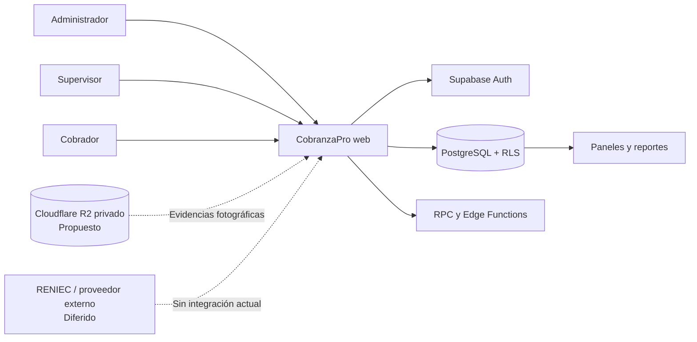
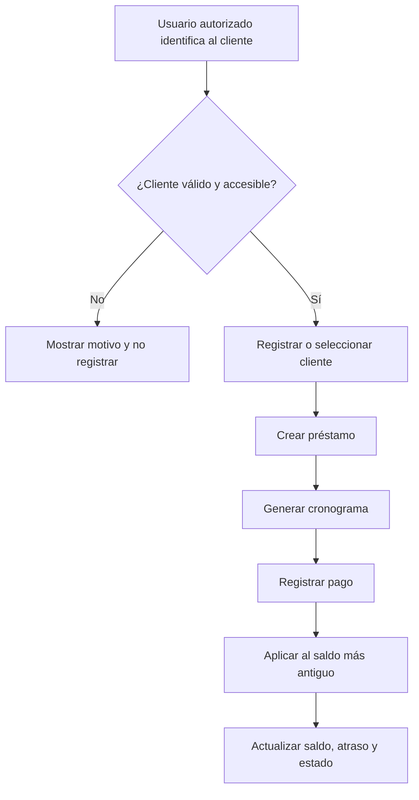
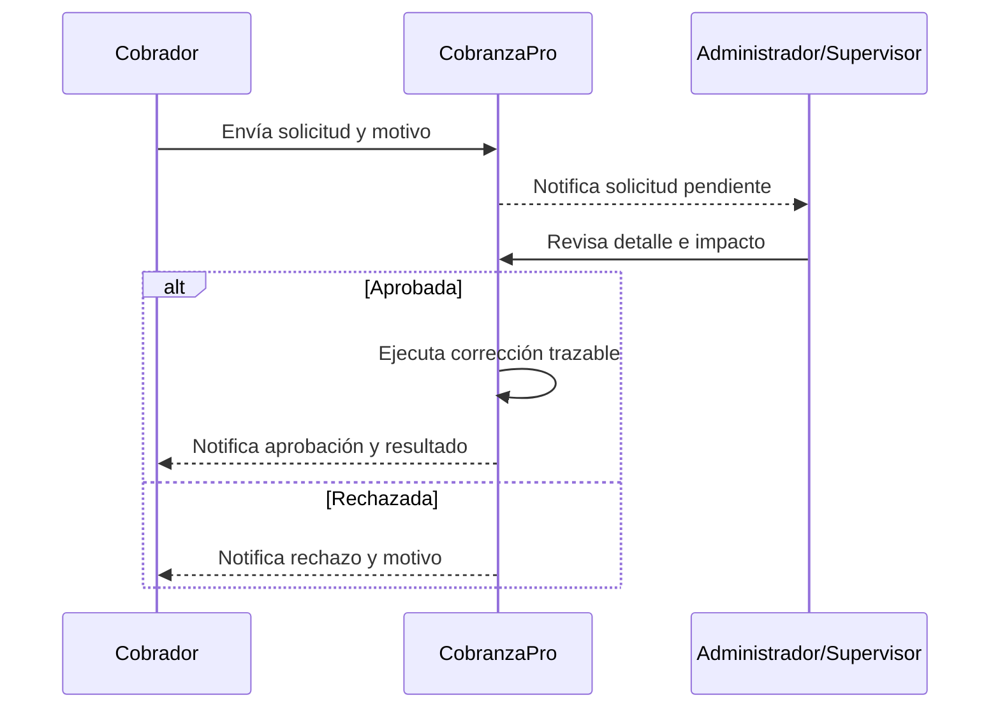
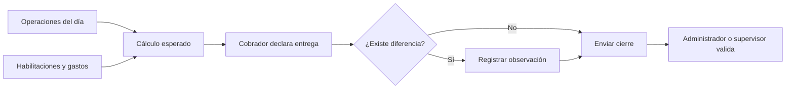

# CobranzaPro — Documento funcional

Este documento define **qué debe hacer CobranzaPro**, quién puede realizar cada operación y qué criterios se usarán para aceptar la solución. También separa con claridad lo que ya está implementado de lo que sigue pendiente, para evitar que una propuesta futura se interprete como una funcionalidad entregada.

> **Nota de aceptación:** este documento establece requisitos y criterios de aceptación. Los casos ejecutados, datos de prueba, evidencias, incidencias y resultados de aceptación se registrarán en un **Plan y acta de pruebas UAT independiente**.

## 1. Control del documento

| Campo | Valor |
|---|---|
| Código | CP-DF-001 |
| Nombre | Documento funcional de CobranzaPro |
| Versión | 0.1 |
| Fecha | 11 de noviembre de 2026 |
| Estado | Borrador para revisión y validación del cliente |
| Elaborado por | Equipo TI |
| Revisado por | Equipo TI |
| Aprobado por | ______________________________ |
| Organización cliente | ______________________________ |

### 1.1 Historial de cambios

| Versión | Fecha | Descripción | Responsable |
|---|---|---|---|
| 0.1 | 11/11/2026 | Primera consolidación funcional basada en requisitos y estado actual del sistema | Por completar |

### 1.2 Estados utilizados

| Estado | Significado |
|---|---|
| **Implementado** | Existe evidencia en la aplicación, base de datos, funciones o rutas actuales. No sustituye la validación UAT. |
| **Parcial** | Existe una parte operativa, pero falta alcance solicitado, validación o una salida complementaria. |
| **Propuesto** | El comportamiento está definido para una fase posterior, pero todavía no forma parte de la solución operativa. |
| **Pendiente** | Requisito identificado sin implementación completa. |
| **Diferido** | Excluido de la entrega actual por decisión del proyecto. Requiere aprobación para reactivarse. |
| **Validación operativa** | Depende de configuración, infraestructura o evidencia de operación que no puede confirmarse solo con el código. |

## 2. Propósito y objetivos

### 2.1 Propósito

CobranzaPro centraliza la administración de clientes, préstamos, cuotas, cobranzas, morosidad, carteras de cobradores, solicitudes de corrección y cierres de caja. Su finalidad es reemplazar controles dispersos por una fuente única, protegida por roles y con trazabilidad de las operaciones financieras.

### 2.2 Objetivos

1. Registrar y consultar la cartera asignada a cada cobrador.
2. Calcular préstamos y cronogramas con reglas uniformes.
3. Registrar pagos parciales, completos y adelantados sin perder trazabilidad.
4. Detectar automáticamente atrasos y restricciones por morosidad.
5. Controlar el efectivo y otros medios entregados al cierre del día.
6. Permitir supervisión central mediante paneles, control diario y exportaciones.
7. Restringir el acceso y las operaciones según el rol y la cartera asignada.
8. Preservar evidencia suficiente para corregir operaciones sin borrar el historial financiero.

## 3. Interesados

| Interesado | Necesidad principal |
|---|---|
| Propietario o dirección | Visibilidad global, control financiero y continuidad operativa. |
| Administrador | Gestionar usuarios, carteras, préstamos, correcciones y cierres. |
| Supervisor | Supervisar carteras, revisar operaciones y validar cierres sin administrar usuarios. |
| Cobrador | Trabajar únicamente con su cartera, registrar clientes, préstamos, pagos y su cierre. |
| Cliente prestatario | Recibir un registro correcto de préstamo, cuota, pago y saldo. No es usuario directo del sistema en el alcance actual. |
| Equipo de soporte/operaciones | Mantener configuración, respaldos, despliegues y atención de incidentes. |
| Responsable de protección de datos | Controlar finalidad, acceso, conservación y eliminación de datos personales y fotografías. |

## 4. Contexto de la solución

La aplicación es una solución web adaptable a móvil y escritorio. Supabase proporciona autenticación, base de datos, seguridad por filas, operaciones transaccionales y funciones privilegiadas. Cloudflare R2 se considera únicamente para la futura evidencia fotográfica privada.

## 5. Alcance

### 5.1 Incluido en el alcance funcional actual

- Acceso con DNI y PIN de seis dígitos.
- Roles de administrador, supervisor y cobrador.
- Gestión de clientes, cobradores, préstamos y cronogramas.
- Registro y asignación de pagos.
- Control de morosidad y bloqueo automático para renovación.
- Solicitudes y aprobación/rechazo de correcciones financieras.
- Panel administrativo y panel de trabajo del cobrador.
- Control diario por fecha y cobrador.
- Cierre de caja, gastos, habilitaciones y validación.
- Exportación del control diario a CSV, Excel y PDF.
- Restricción horaria del cobrador y bloqueo por intentos fallidos de PIN.
- Diseño adaptable para uso móvil y de escritorio.

### 5.2 Incluido como evolución propuesta o pendiente

- Dos fotografías obligatorias por cliente: DNI y persona a cobrar.
- Almacenamiento privado de las fotografías en Cloudflare R2.
- Importación masiva controlada desde Excel/CSV.
- Módulo visual completo de auditoría.
- Cobertura completa de reportes y exportación TXT solicitada.
- Validación operativa de respaldos, recuperación y monitoreo.

### 5.3 Fuera del alcance actual

- Consulta automática a RENIEC o a proveedores privados de identidad. Esta integración está **diferida y no se promete en esta entrega**.
- Aplicación móvil nativa para Android o iOS.
- Cobro en línea mediante pasarela de pago.
- Contabilidad general, facturación electrónica o planilla.
- Cálculo de penalidades o intereses moratorios no aprobados por el cliente.
- Eliminación física del historial de pagos para “corregir” operaciones.

## 6. Roles y matriz de acceso

| Capacidad | Administrador | Supervisor | Cobrador |
|---|:---:|:---:|:---:|
| Acceso 24/7 | Sí | Sí | No; solo 07:00–20:00, hora de Lima |
| Ver todas las carteras | Sí | Sí | No; solo la propia |
| Crear y administrar usuarios cobradores | Sí | No | No |
| Registrar clientes | Sí | Sí | Sí, en su propia cartera |
| Editar datos de clientes | Sí | Sí | Limitado a su cartera y permisos vigentes |
| Crear préstamos | Sí | Sí | Sí, para su cartera |
| Editar un préstamo ya registrado | Sí | Sí | No; debe solicitar corrección |
| Registrar pagos | Sí | Sí | Sí, para su cartera |
| Anular/corregir pagos directamente | Según flujo aprobado | Según flujo aprobado | No; debe solicitar corrección |
| Consultar control diario global | Sí | Sí | No |
| Registrar su cierre de caja | Según operación | Según operación | Sí |
| Validar cierres | Sí | Sí | No |
| Aprobar/rechazar solicitudes | Sí | Sí | No |
| Exportar reportes globales | Sí | Sí | No |

> La seguridad efectiva no depende solo de ocultar opciones en pantalla: las reglas se aplican en la base de datos y en las funciones autorizadas.

## 7. Glosario

| Término | Definición |
|---|---|
| Cartera | Conjunto de clientes asignados a un cobrador. |
| Capital | Monto original entregado al cliente. |
| Interés | Porcentaje simple aplicado una sola vez al capital. |
| Total a pagar | Capital más el interés acordado. |
| Cuota | Parte programada del total a pagar. |
| Saldo | Importe pendiente de pago. |
| Mora | Atraso acumulado respecto del cronograma vigente. |
| Lista de restricción | Estado automático que impide renovar cuando existen más de cinco días de atraso acumulado. |
| Renovación | Nuevo préstamo que cierra y enlaza el préstamo anterior, incorporando el saldo pendiente cuando corresponda. |
| Cierre de caja | Conciliación diaria entre importes esperados, registrados y entregados. |
| Habilitación | Entrega o movimiento de efectivo autorizado para la operación del cobrador. |
| Solicitud de corrección | Pedido trazable para modificar o anular una operación financiera sin borrar su historia. |
| RLS | Seguridad por filas que limita qué registros puede leer o modificar cada usuario. |
| UAT | Pruebas de aceptación ejecutadas por usuarios del negocio o sus representantes. |

## 8. Reglas de negocio

1. **Interés simple:** el total se calcula como `capital + capital × tasa / 100`. La tasa predeterminada es 20 %, pero puede modificarse al crear el préstamo.
2. **Cuotas exactas:** el total se divide entre el número de cuotas y la última absorbe cualquier diferencia de redondeo.
3. **Calendario diario:** las cuotas diarias se programan de lunes a sábado; el domingo se omite. Los feriados se cobran normalmente salvo cambio aprobado.
4. **Calendario semanal:** conserva el mismo día de la semana.
5. **Calendario mensual:** conserva el día del mes. Si cae domingo, pasa al lunes; si ese lunes pertenece al mes siguiente, se traslada al sábado anterior.
6. **Aplicación de pagos:** los pagos cubren primero la cuota vencida más antigua. Se permiten pagos parciales, completos y adelantados.
7. **Un préstamo activo:** un cliente no puede mantener más de un préstamo activo al mismo tiempo.
8. **Renovación:** debe cerrar y enlazar el préstamo anterior; cualquier saldo pendiente se incorpora conforme a la operación aprobada.
9. **Restricción automática:** con más de cinco días de atraso acumulado el cliente queda restringido para renovar; sale automáticamente al ponerse al día. No se aplica penalidad adicional por este estado.
10. **Correcciones trazables:** un pago publicado no se elimina. La corrección registra solicitante, revisor, fecha, motivo y resultado.
11. **Asignación de cartera:** un cobrador solo consulta y opera sobre sus clientes. Una reasignación requiere una operación administrativa explícita.
12. **Horario del cobrador:** el acceso se autoriza desde las 07:00 inclusive hasta antes de las 20:00, usando `America/Lima`. La regla implementada es horaria y no añade actualmente un bloqueo específico para domingos.
13. **Cierre diario:** se comparan importes esperados, cobrados y entregados; las diferencias exigen observación y revisión.
14. **Integridad financiera:** movimientos, pagos y correcciones deben conservar su historial; no se admite el borrado físico como mecanismo de ajuste.

## 9. Flujos funcionales clave

### 9.1 Alta de cliente, préstamo y cobranza

### 9.2 Corrección de una operación financiera

### 9.3 Cierre de caja

## 10. Requisitos funcionales

### 10.1 Acceso y seguridad de sesión

| ID | Requisito | Estado | Criterio de aceptación |
|---|---|---|---|
| RF-AUT-01 | Iniciar sesión con DNI y PIN de seis dígitos. | Implementado | Con credenciales válidas se inicia la sesión y se dirige al área correspondiente al rol; con credenciales inválidas no se concede acceso. |
| RF-AUT-02 | Obligar al cambio de PIN cuando el perfil lo requiera. | Implementado | El usuario marcado para cambio no accede a módulos operativos hasta completar el nuevo PIN. |
| RF-AUT-03 | Permitir al usuario cambiar su PIN y al administrador restablecer el PIN de un cobrador. | Implementado | El nuevo PIN cumple las reglas de seguridad, la operación finaliza sin exponer credenciales privilegiadas y la sesión se renueva o cierra según corresponda. |
| RF-AUT-04 | Bloquear la cuenta tras cinco intentos fallidos consecutivos de PIN. | Implementado | Al alcanzar el límite, la cuenta pierde acceso a autenticación y operaciones protegidas hasta el mecanismo de recuperación autorizado. |
| RF-AUT-05 | Restringir el acceso del cobrador a 07:00–20:00, hora de Lima. | Implementado | Antes de 07:00 y desde 20:00 el cobrador no puede operar; administrador y supervisor permanecen sin restricción horaria. |
| RF-AUT-06 | Cerrar sesiones por inactividad. | Pendiente | El tiempo de inactividad debe acordarse; vencido el plazo, el usuario debe volver a autenticarse sin perder una operación financiera ya confirmada. |

### 10.2 Usuarios, cobradores y carteras

| ID | Requisito | Estado | Criterio de aceptación |
|---|---|---|---|
| RF-USR-01 | Crear, editar, activar y desactivar cobradores. | Implementado | Solo el administrador ejecuta operaciones de cuenta; las modificaciones quedan asociadas al usuario actuante y las cuentas inactivas no operan. |
| RF-USR-02 | Consultar el desempeño de cobradores. | Implementado | El administrador o supervisor visualiza clientes, esperado, cobrado, pendiente y atrasos por cobrador. |
| RF-USR-03 | Reasignar masivamente una cartera cuando un cobrador deja la empresa. | Pendiente | Un administrador selecciona origen y destino, confirma el alcance y el sistema reasigna de forma transaccional sin dejar clientes sin responsable. |
| RF-USR-04 | Importar clientes, préstamos y cuotas desde una plantilla Excel/CSV validada. | Pendiente | La importación muestra previsualización, errores por fila y resumen; ninguna fila se confirma si falla la validación transaccional acordada. |

### 10.3 Clientes

| ID | Requisito | Estado | Criterio de aceptación |
|---|---|---|---|
| RF-CLI-01 | Registrar clientes con documento, nombre, contacto, dirección y cobrador asignado. | Implementado | Los campos obligatorios y formatos se validan, el documento no se duplica y el cliente queda visible solo para roles autorizados. |
| RF-CLI-02 | Buscar, filtrar y paginar clientes. | Implementado | La consulta devuelve páginas consistentes y respeta el filtro y el alcance de cartera sin cargar todo el padrón en el navegador. |
| RF-CLI-03 | Editar datos de un cliente sin ejecutar una escritura cuando no existe cambio real. | Implementado | El botón de guardado permanece inactivo o la operación se omite si los valores finales coinciden con los originales. |
| RF-CLI-04 | Adjuntar obligatoriamente una foto del DNI y una foto de la persona a cobrar. | Propuesto | En una fase aprobada, el alta no se completa sin ambas imágenes válidas; cada archivo pesa como máximo 1 MB y no queda públicamente accesible. |
| RF-CLI-05 | Reemplazar una fotografía eliminando la versión anterior. | Propuesto | La imagen anterior se elimina solo después de confirmar el almacenamiento de la nueva; ante error se conserva la evidencia vigente. |
| RF-CLI-06 | Completar datos mediante consulta RENIEC. | Diferido | No aplica a esta entrega. Cualquier reactivación requiere proveedor, contrato, límites, consentimiento, seguridad y presupuesto aprobados. |

### 10.4 Préstamos, cronogramas y renovaciones

| ID | Requisito | Estado | Criterio de aceptación |
|---|---|---|---|
| RF-PRE-01 | Crear un préstamo con capital, tasa, número de cuotas, frecuencia y fechas. | Implementado | El total, cuotas y cronograma respetan las reglas de negocio y la creación financiera se confirma de forma atómica. |
| RF-PRE-02 | Generar frecuencias diaria, semanal y mensual. | Implementado | Las fechas generadas cumplen las reglas de calendario y la suma de cuotas coincide exactamente con el total. |
| RF-PRE-03 | Impedir más de un préstamo activo por cliente. | Implementado | Un segundo préstamo activo es rechazado con un mensaje comprensible y sin escritura parcial. |
| RF-PRE-04 | Editar préstamos existentes solo con autorización y motivo auditable. | Implementado | Solo administrador o supervisor modifica; el motivo es obligatorio y se conserva el antes/después. |
| RF-PRE-05 | Renovar un préstamo y enlazarlo con el anterior. | Implementado | La renovación cierra el préstamo previo, conserva el vínculo y traslada el saldo permitido en una sola operación consistente. |
| RF-PRE-06 | Impedir renovaciones para clientes en estado de restricción. | Implementado | La renovación se rechaza mientras existan más de cinco días de atraso y se habilita automáticamente al regularizarse. |

### 10.5 Pagos, morosidad y correcciones

| ID | Requisito | Estado | Criterio de aceptación |
|---|---|---|---|
| RF-COB-01 | Registrar pagos parciales, completos y adelantados. | Implementado | El pago se asigna desde la deuda más antigua, no supera las reglas permitidas y actualiza saldo y cronograma sin inconsistencias. |
| RF-COB-02 | Calcular días de atraso y estado de restricción automáticamente. | Implementado | Con hasta cinco días no se restringe; con más de cinco se restringe; al quedar al día se retira la restricción. |
| RF-COB-03 | Conservar pagos y correcciones sin borrado físico. | Implementado | Una anulación cambia el estado y genera trazabilidad; el registro original continúa consultable para usuarios autorizados. |
| RF-COR-01 | Permitir al cobrador solicitar edición o anulación con motivo. | Implementado | La solicitud queda pendiente, vinculada a la operación y visible para administrador/supervisor. |
| RF-COR-02 | Aprobar o rechazar solicitudes y notificar el resultado en tiempo cercano al real. | Implementado | La resolución registra revisor, fecha y motivo; solicitante y revisores reciben actualización sin depender de recargar toda la aplicación. |

### 10.6 Control diario, caja y reportes

| ID | Requisito | Estado | Criterio de aceptación |
|---|---|---|---|
| RF-CAJ-01 | Calcular el cierre por cobrador y fecha con importes esperados, entregados y diferencia. | Implementado | El resumen considera los movimientos aplicables del día y muestra cualquier diferencia antes del envío. |
| RF-CAJ-02 | Registrar efectivo, Yape u otros medios, habilitaciones y gastos. | Implementado | Cada movimiento conserva tipo, monto, responsable, fecha y observación exigible. |
| RF-CAJ-03 | Permitir reenvío antes de validación e impedir cambios no autorizados después de validar. | Implementado | Existe un solo cierre por cobrador y fecha; la validación registra quién y cuándo la realizó. |
| RF-REP-01 | Mostrar panel administrativo con indicadores y rendimiento por cobrador. | Implementado | Los indicadores se obtienen del origen operativo y permiten acceder a la cartera correspondiente. |
| RF-REP-02 | Consultar control diario histórico por fecha, cobrador y estado. | Implementado | Los importes se calculan al corte seleccionado y no incluyen pagos posteriores a esa fecha. |
| RF-REP-03 | Exportar el control diario a CSV, Excel y PDF. | Implementado | Cada formato contiene los datos filtrados y la fecha de corte; si no existen filas, no se genera un archivo vacío. |
| RF-REP-04 | Exportar reportes en TXT y completar el catálogo por día, semana y mes. | Parcial | Se debe acordar el catálogo y estructura TXT; actualmente el control diario ofrece CSV, XLSX y PDF. |
| RF-AUD-01 | Consultar una pantalla consolidada de auditoría. | Pendiente | El usuario autorizado filtra eventos por fecha, actor, entidad y acción, y puede revisar antes/después sin alterar registros. |

## 11. Requisitos no funcionales

| ID | Categoría | Requisito | Estado / criterio verificable |
|---|---|---|---|
| RNF-01 | Seguridad | Aplicar mínimo privilegio mediante roles, RLS, RPC y funciones privilegiadas. | Implementado; las pruebas deben intentar acceso cruzado entre carteras y operaciones no autorizadas. |
| RNF-02 | Integridad | Ejecutar operaciones financieras críticas de forma transaccional e idempotente cuando corresponda. | Implementado en operaciones principales; cada nueva importación masiva deberá demostrar atomicidad. |
| RNF-03 | Privacidad | No publicar documentos, fotografías, PIN ni credenciales; usar accesos temporales para archivos privados. | Implementado para credenciales; propuesto para fotografías R2. |
| RNF-04 | Rendimiento | Paginar consultas voluminosas y cargar funciones pesadas solo cuando se usan. | Implementado en clientes y exportaciones principales; debe medirse con volumen representativo. |
| RNF-05 | Disponibilidad | Mantener el servicio disponible durante el horario operativo acordado. | Validación operativa; requiere objetivo de disponibilidad y monitoreo aprobados. |
| RNF-06 | Respaldo y recuperación | Contar con respaldos y un procedimiento probado de restauración. | Validación operativa; la existencia y frecuencia del respaldo no se consideran aceptadas sin evidencia de configuración y restauración. |
| RNF-07 | Compatibilidad | Operar en navegadores modernos y adaptar la interfaz a móvil, tableta y escritorio. | Implementado a nivel de diseño; UAT debe cubrir dispositivos representativos, incluido móvil de uso real. |
| RNF-08 | Accesibilidad | Cumplir como mínimo WCAG 2.1 AA en navegación, contraste, foco y etiquetas. | Parcial; requiere auditoría automatizada y manual antes de aceptación final. |
| RNF-09 | Localización | Usar español de Perú, moneda PEN y zona horaria `America/Lima`. | Implementado en reglas y presentación principal. |
| RNF-10 | Trazabilidad | Registrar actor, fecha, motivo y resultado de operaciones sensibles. | Implementado en flujos financieros principales; pantalla consolidada de auditoría pendiente. |
| RNF-11 | Mantenibilidad | Separar reglas de negocio, acceso a datos y presentación, y versionar cambios de base de datos. | Implementado mediante repositorios, adaptadores, stores y migraciones. |
| RNF-12 | Capacidad | Soportar al menos 6–10 usuarios operativos y carteras aproximadas de 100–110 clientes por cobrador. | Requiere prueba de volumen y concurrencia con datos equivalentes antes de aceptación. |

## 12. Seguridad, privacidad y auditoría

### 12.1 Controles actuales

- Autenticación individual por DNI y PIN.
- Bloqueo por intentos fallidos y cambio obligatorio de PIN cuando corresponde.
- Restricción horaria del cobrador aplicada en el límite de autorización de datos.
- Separación de carteras mediante RLS y funciones de base de datos.
- Operaciones privilegiadas realizadas por Edge Functions o RPC, sin exponer claves administrativas al navegador.
- Pagos y correcciones con conservación del historial.
- Notificación en tiempo cercano al real para solicitudes de corrección.

### 12.2 Controles requeridos para fotografías

Cuando se apruebe RF-CLI-04, las imágenes deben almacenarse en un bucket R2 privado. Solo el cobrador asignado, el administrador y el supervisor podrán solicitarlas. La aplicación debe emitir acceso temporal, registrar operaciones sensibles y evitar URLs públicas permanentes. La sustitución debe eliminar la imagen anterior después de confirmar la nueva carga.

Antes de activar esta función se debe aprobar: consentimiento o base legítima, texto informativo al cliente, plazo de conservación, procedimiento de atención de derechos y respuesta ante incidentes. Las fotografías son datos personales; la foto del DNI aumenta el impacto de una exposición.

### 12.3 Auditoría

La base funcional conserva metadatos y estados de operaciones financieras. Sin embargo, la pantalla central de auditoría continúa pendiente. Hasta completarla, la trazabilidad técnica no debe presentarse como un módulo de auditoría terminado para usuarios finales.

## 13. Dependencias externas

| Dependencia | Uso | Estado | Consideración |
|---|---|---|---|
| Supabase Auth | Identidad y sesión | En uso | Disponibilidad, límites y configuración por ambiente. |
| Supabase PostgreSQL/RLS/RPC | Datos, permisos y transacciones | En uso | Migraciones, índices, pruebas y respaldos. |
| Supabase Edge Functions | Operaciones privilegiadas | En uso | Despliegue coordinado con la aplicación y secretos seguros. |
| Supabase Realtime | Solicitudes y notificaciones operativas | En uso acotado | Usar solo donde una actualización inmediata aporta valor. |
| Cloudflare | Publicación web | En uso/según ambiente | Dominio, caché, certificados y variables de despliegue. |
| Cloudflare R2 | Fotografías privadas | Propuesto | Costos, límites, CORS, URLs temporales, borrado y retención. |
| Proveedor RENIEC | Consulta de identidad | Diferido | No existe compromiso funcional ni comercial en esta entrega. |
| Excel/PDF | Exportación local | En uso | Las bibliotecas se cargan bajo demanda; validar archivos con datos reales. |

## 14. Datos, conservación y eliminación

1. Los registros financieros, pagos, anulaciones, cierres y correcciones no deben eliminarse físicamente como forma de ajuste.
2. Los datos personales deben conservarse solo durante el periodo legal y comercial que el cliente apruebe. Este documento no inventa un plazo.
3. La eliminación o anonimización al finalizar la relación debe respetar las obligaciones de conservación financiera y auditoría.
4. Las fotografías R2, cuando se implementen, usarán identificadores no predecibles, almacenamiento privado y acceso temporal.
5. Al reemplazar una fotografía, la anterior se elimina tras confirmar la nueva; los fallos deben quedar registrados para evitar archivos huérfanos.
6. Los ambientes de desarrollo, UAT y producción deben mantener datos y credenciales separados.
7. Las copias de respaldo deben incluir un procedimiento documentado de restauración y una prueba periódica; tener un respaldo sin probarlo no demuestra recuperación.

## 15. Supuestos, riesgos y decisiones pendientes

| Tema | Supuesto o riesgo | Acción requerida |
|---|---|---|
| Reglas de negocio | `REQUERIMIENTO.md` es la referencia funcional vigente, pero debe ser ratificada por el cliente. | Revisar y firmar esta versión o registrar observaciones. |
| Horario | La restricción 07:00–20:00 se aplica todos los días; no existe bloqueo dominical específico. | Confirmar si el domingo solo se omite del cronograma o también del acceso. |
| Datos iniciales | La carga masiva desde la hoja real todavía no está implementada. | Definir plantilla, validaciones, estrategia de reversión y responsable. |
| Fotografías | Aumentan el riesgo de privacidad y soporte; R2 aún no está integrado. | Aprobar política, presupuesto, consentimiento y diseño antes de desarrollar. |
| RENIEC | Los planes gratuitos de terceros pueden cambiar y no equivalen a un servicio oficial garantizado. | Mantener diferido hasta contar con proveedor y contrato aprobados. |
| Auditoría | Existe trazabilidad técnica, pero no pantalla consolidada. | Priorizar RF-AUD-01 si el cliente necesita consulta autónoma. |
| Exportaciones | TXT y catálogo completo siguen pendientes. | Acordar qué reportes son obligatorios y su estructura. |
| Calidad | Las pruebas existentes no sustituyen UAT con usuarios y datos representativos. | Ejecutar el documento UAT independiente antes de la conformidad final. |
| Operación | Respaldo, restauración, monitoreo y disponibilidad dependen del ambiente desplegado. | Incorporar evidencia en el manual técnico/operativo. |

## 16. Aceptación y trazabilidad UAT

### 16.1 Relación entre este documento y UAT

- Este documento define **el comportamiento esperado** y sus criterios de aceptación.
- El documento UAT define **cómo se prueba**: precondiciones, datos, pasos y resultado esperado.
- El acta o evidencia UAT registra **qué ocurrió**: responsable, fecha, evidencia, resultado y defecto encontrado.
- La firma de este documento valida el alcance funcional; la aceptación final de la entrega se formaliza en un **Acta de entrega y conformidad** separada.

### 16.2 Matriz de trazabilidad mínima

| Requisito | Caso UAT | Ambiente | Resultado | Evidencia | Incidencia |
|---|---|---|---|---|---|
| RF-AUT-01 | UAT-AUT-001 | UAT | Pendiente | Pendiente | — |
| RF-PRE-01 | UAT-PRE-001 | UAT | Pendiente | Pendiente | — |
| RF-COB-01 | UAT-COB-001 | UAT | Pendiente | Pendiente | — |
| RF-COR-02 | UAT-COR-001 | UAT | Pendiente | Pendiente | — |
| RF-CAJ-01 | UAT-CAJ-001 | UAT | Pendiente | Pendiente | — |
| RF-REP-03 | UAT-REP-001 | UAT | Pendiente | Pendiente | — |

La matriz completa debe incluir todos los requisitos aprobados con estado Implementado o Parcial. Los requisitos Propuestos, Pendientes o Diferidos no bloquean la aceptación de esta versión salvo que el contrato los declare obligatorios para la entrega.

## 17. Gestión de cambios

1. Toda solicitud se registra con descripción, motivo, solicitante y fecha.
2. El equipo evalúa impacto funcional, técnico, de seguridad, plazo y costo.
3. El cliente aprueba, rechaza o posterga el cambio antes de su implementación.
4. Los cambios aprobados actualizan este documento, los casos UAT y, cuando corresponda, el manual de usuario y el manual técnico.
5. Cada versión conserva historial y responsables de revisión.
6. Un cambio regulatorio, de cálculo financiero o de privacidad requiere aprobación explícita; no se asume por interpretación del equipo técnico.

## 18. Conformidad del documento funcional

Las firmas siguientes dejan constancia de que el alcance y los criterios de aceptación fueron revisados. No reemplazan el Acta de entrega y conformidad final.

| Por el cliente | Por el proveedor/equipo |
|---|---|
| Nombre: ______________________________ | Nombre: ______________________________ |
| Cargo: _______________________________ | Cargo: _______________________________ |
| Documento: ___________________________ | Documento: ___________________________ |
| Firma: _______________________________ | Firma: _______________________________ |
| Fecha: _______________________________ | Fecha: _______________________________ |

## Anexo A. Paquete documental recomendado para la entrega

No conviene reducir la entrega a solo tres documentos. Para que el cliente pueda **entender, validar, operar y aceptar** el sistema, el paquete mínimo recomendado es:

| N.° | Documento | Propósito |
|---:|---|---|
| 1 | **Documento funcional** | Define alcance, reglas, requisitos y criterios de aceptación. Es el presente documento. |
| 2 | **Manual de usuario** | Explica tareas por rol con pasos, capturas, mensajes y resolución de problemas frecuentes. |
| 3 | **Plan y evidencia de pruebas UAT** | Contiene casos, datos, responsables, resultados, evidencias, incidencias y conformidad de usuarios. |
| 4 | **Acta de entrega y conformidad** | Formaliza versión, entregables, observaciones, pendientes aceptados, fecha y firmas. |
| 5 | **Manual técnico y de operaciones** | Documenta arquitectura, ambientes, despliegue, configuración, respaldos, restauración, monitoreo y soporte. |

El contrato o acuerdo comercial puede incluir anexos adicionales —por ejemplo, tratamiento de datos personales, niveles de servicio o capacitación—, pero no debería mezclar la evidencia UAT dentro del documento funcional: son artefactos con objetivos y responsables distintos.

## Anexo B. Fuentes de referencia

- `REQUERIMIENTO.md`: reglas y expectativas del negocio.
- `AGENTS.md`: arquitectura, convenciones y estado documentado de los módulos.
- Rutas de administración, cobrador y autenticación en `src/app/`.
- Modelos, repositorios, adaptadores y stores de clientes, préstamos, pagos, correcciones, control diario y cierre de caja.
- Migraciones de Supabase para seguridad, reglas financieras, cierres, correcciones, acceso horario y reportes.
- Funciones de Supabase para inicio de sesión y administración de PIN/cobradores.
- `openspec/changes/add-customer-identity-evidence/proposal.md`: propuesta técnica aún no implementada para evidencia fotográfica; la consulta RENIEC queda diferida por decisión posterior del proyecto.

