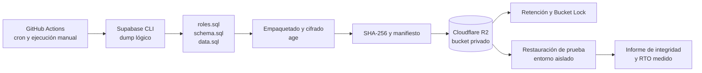

# Especificación técnica: respaldos de Supabase en Cloudflare R2

**Proyecto:** CobranzaPro  
**Estado:** propuesta técnica  
**Fecha:** 22 de noviembre de 2026  
**Alcance:** base de datos PostgreSQL de producción

## 1. Resumen ejecutivo

CobranzaPro debe generar respaldos lógicos de su base de datos Supabase mediante un
workflow programado de GitHub Actions, cifrarlos antes de salir del runner y almacenarlos
en un bucket privado de Cloudflare R2.

Cloudflare R2 **no crea el backup de PostgreSQL**. R2 será solamente el almacenamiento
externo. La extracción, validación, cifrado y carga serán responsabilidad del workflow.

La solución recomendada es:

1. GitHub Actions ejecuta diariamente `supabase db dump` contra producción.
2. El dump se divide en roles, esquema y datos, siguiendo el procedimiento oficial de
   Supabase.
3. Los archivos se empaquetan y cifran del lado cliente con una clave pública de `age`.
4. Se calcula un checksum SHA-256 del artefacto cifrado.
5. El artefacto se sube a un bucket privado de R2 mediante su API compatible con S3.
6. R2 aplica retención, bloqueo contra borrado y eliminación por ciclo de vida.
7. Periódicamente se realiza una restauración de prueba en un entorno aislado.

### Decisión de costo

La primera versión **puede operar sin pago** mientras se mantenga dentro de los límites
gratuitos vigentes de Cloudflare R2 y de los minutos incluidos de GitHub Actions. No debe
presentarse como costo cero garantizado.

La capa gratuita actual de R2 Standard incluye mensualmente:

- 10 GB-mes de almacenamiento.
- 1 millón de operaciones Class A.
- 10 millones de operaciones Class B.
- egreso gratuito desde R2.

El costo relevante será principalmente el almacenamiento acumulado, no las pocas
operaciones diarias del workflow. Si se excede el límite, R2 cobra por consumo. La tarifa
oficial debe revisarse antes de activar producción porque puede cambiar.

## 2. Situación actual verificada

- Supabase Free no incluye backups automáticos administrados. Supabase recomienda que los
  proyectos Free exporten periódicamente la base con Supabase CLI y conserven una copia
  fuera de la plataforma.
- El repositorio ya utiliza GitHub Actions para CI/CD, Supabase CLI y Cloudflare Wrangler.
- `wrangler.jsonc` configura únicamente el despliegue estático de Angular; no existe un
  servicio de backups.
- La aplicación actualmente no usa Supabase Storage como repositorio de archivos.
- Las migraciones de `supabase/migrations/` siguen siendo la fuente autoritativa del
  esquema, pero no reemplazan un backup de los datos.

## 3. Objetivos

### 3.1 Objetivos funcionales

- Generar un respaldo automático diario de producción.
- Permitir una ejecución manual controlada antes de cambios de alto riesgo.
- Conservar los respaldos fuera de Supabase.
- Evitar que una credencial de R2 exponga el contenido financiero en texto plano.
- Detectar fallos de generación, cifrado o carga.
- Probar que el respaldo puede restaurarse.

### 3.2 Objetivos de recuperación

- **RPO inicial:** hasta 24 horas de datos, por tratarse de un backup nocturno.
- **RTO inicial:** no se promete un valor hasta medir una restauración real.
- **Objetivo de restauración:** recuperar esquema, datos, relaciones, políticas, funciones y
  las identidades necesarias para que los usuarios puedan volver a operar.

Esta solución no proporciona recuperación a un punto exacto en el tiempo (PITR). Si el
negocio exige perder como máximo minutos, será necesario evaluar Supabase Pro/PITR u otra
arquitectura de replicación.

## 4. Arquitectura propuesta



### 4.1 Responsabilidades

| Componente | Responsabilidad |
|---|---|
| GitHub Actions | Programar, ejecutar y auditar el proceso. |
| Supabase CLI | Producir los dumps lógicos de PostgreSQL. |
| `age` | Cifrar el artefacto antes de almacenarlo. |
| SHA-256 | Verificar integridad durante carga y restauración. |
| Cloudflare R2 | Conservar los objetos cifrados fuera de Supabase. |
| R2 Bucket Lock | Evitar sobrescritura o borrado prematuro. |
| R2 Lifecycle | Eliminar automáticamente objetos fuera de retención. |
| Runbook de restauración | Definir el procedimiento humano y sus validaciones. |

## 5. Por qué usar GitHub Actions y no un Cloudflare Worker

El backup necesita ejecutar herramientas nativas como Supabase CLI/`pg_dump`, manejar
archivos temporales, comprimirlos y realizar verificaciones. Un runner Linux de GitHub
Actions está preparado para ese trabajo.

Un Worker con Cron Trigger sería una capa adicional que no resuelve por sí sola la
extracción de PostgreSQL y agrega complejidad operativa. No aporta valor en esta primera
versión.

Cloudflare participa donde es fuerte: almacenamiento S3, retención y egreso económico.

## 6. Alcance del respaldo

### 6.1 Contenido mínimo

Cada ejecución debe producir:

```text
roles.sql
schema.sql
data.sql
manifest.json
checksums.sha256
```

El flujo oficial separa roles, esquema y datos. Esto facilita diagnosticar fallos y
restaurar en el orden correcto.

El `manifest.json` no debe contener secretos ni datos personales. Debe incluir como mínimo:

- proyecto lógico: `cobranzapro`;
- ambiente: `prod` o `dev`;
- fecha UTC de inicio y fin;
- versión de Supabase CLI;
- tamaño de cada archivo;
- checksum del artefacto final;
- resultado de las validaciones;
- identificador del workflow y commit de origen.

### 6.2 Historial de migraciones

Debe evaluarse el respaldo de `supabase_migrations` siguiendo el procedimiento oficial de
restauración. Su finalidad es reconciliar el proyecto restaurado con el historial local de
`supabase/migrations/`; no reemplaza los archivos versionados en Git.

### 6.3 Supabase Auth

No se debe asumir que un dump exitoso garantiza por sí solo la recuperación completa de
usuarios de Auth. Supabase trata algunos esquemas administrados de manera especial.

La prueba de restauración debe confirmar expresamente:

- preservación de los UUID de `auth.users` utilizados por `profiles`;
- integridad de las relaciones con cobradores, clientes y operaciones;
- inicio de sesión de un usuario de prueba restaurado;
- validez de RLS y de los RPC protegidos.

Si esa prueba demuestra que las identidades no son portables con el dump estándar, el
procedimiento deberá incorporar el mecanismo oficial soportado para Auth antes de declarar
la solución lista para producción. No es aceptable recrear usuarios con UUID diferentes y
romper las referencias financieras.

### 6.4 Archivos de Storage

Un backup de base de datos conserva metadatos, pero **no incluye los bytes de los objetos de
Supabase Storage**. Si en el futuro se almacenan fotos del cliente o del DNI:

- los objetos de R2 o Storage requieren una copia separada;
- la base debe conservar sus claves/rutas;
- el simulacro debe verificar tanto filas como archivos;
- no debe declararse recuperación completa si solo se restauró PostgreSQL.

## 7. Diseño del workflow

### 7.1 Disparadores

El workflow propuesto será `.github/workflows/backup-production.yml` y tendrá:

- `schedule`: todos los días a las `07:00 UTC`, equivalente a `02:00` en Perú;
- `workflow_dispatch`: ejecución manual autorizada;
- ningún disparador para `pull_request` ni para cada `push`.

Los schedules de GitHub pueden demorarse; el control debe validar la antigüedad del último
backup, no confiar en el minuto exacto de inicio.

### 7.2 Flujo de ejecución

1. Crear un directorio temporal del runner.
2. Instalar versiones fijadas de Supabase CLI y `age`.
3. Ejecutar:

   ```bash
   supabase db dump --db-url "$SUPABASE_DB_URL" -f roles.sql --role-only
   supabase db dump --db-url "$SUPABASE_DB_URL" -f schema.sql
   supabase db dump --db-url "$SUPABASE_DB_URL" -f data.sql --data-only --use-copy
   ```

   Los parámetros exactos deben validarse contra la versión fijada de Supabase CLI antes
   de implementar; no debe usarse una versión flotante.

4. Rechazar archivos vacíos o un dump con código de salida distinto de cero.
5. Generar el manifiesto.
6. Empaquetar y comprimir los archivos.
7. Cifrar con la clave pública de recuperación:

   ```bash
   age -r "$BACKUP_AGE_RECIPIENT" -o "$BACKUP_FILE.age" "$BACKUP_FILE"
   ```

8. Eliminar del directorio temporal los archivos sin cifrar después de verificar el
   artefacto.
9. Calcular SHA-256 sobre el archivo cifrado.
10. Cargar el artefacto y metadatos no sensibles a R2 mediante la API S3.
11. Consultar el objeto cargado (`HeadObject`) y comparar tamaño/checksum.
12. Finalizar con error si cualquier paso falla.

### 7.3 Conectividad de Supabase

Los runners hospedados por GitHub usan IPv4. Para evitar depender del add-on IPv4 de
Supabase, `SUPABASE_DB_URL` debe usar la cadena **Session Pooler** del proyecto, obtenida del
panel de Supabase.

No deben utilizarse en este workflow:

- la publishable key del frontend;
- `service_role`;
- una URL impresa en logs;
- una contraseña colocada en el repositorio.

La credencial requerida es la cadena de conexión PostgreSQL guardada como secreto del
Environment de producción.

### 7.4 Clave del objeto en R2

Cada backup utilizará una clave inmutable y única:

```text
prod/daily/2026/11/22/cobranzapro-prod-20261122T070000Z.tar.zst.age
```

No se debe sobrescribir un objeto `latest`. Si se necesita localizar el más reciente, se
resuelve por nombre/fecha o mediante un manifiesto no destructivo.

## 8. Configuración de Cloudflare R2

### 8.1 Bucket

- Bucket dedicado y privado, por ejemplo `cobranzapro-prod-backups`.
- Acceso público y dominio personalizado deshabilitados.
- Producción y desarrollo separados por bucket; como mínimo, por credenciales y prefijos
  independientes.
- Región automática de R2, salvo una necesidad regulatoria documentada.

### 8.2 Credenciales

Crear un token R2 S3 limitado exclusivamente al bucket de backups con permisos de lectura y
escritura de objetos. No reutilizar el token amplio de despliegue de Cloudflare.

Secretos propuestos en el GitHub Environment `production`:

| Secreto/variable | Uso |
|---|---|
| `SUPABASE_DB_URL` | Session Pooler de producción. |
| `R2_ACCESS_KEY_ID` | Identidad S3 limitada al bucket. |
| `R2_SECRET_ACCESS_KEY` | Secreto S3 limitado al bucket. |
| `R2_ACCOUNT_ID` | Construir el endpoint S3 de R2. |
| `R2_BUCKET` | Nombre del bucket de producción. |
| `BACKUP_AGE_RECIPIENT` | Clave pública de cifrado; puede ser variable no secreta. |

La clave privada de `age` debe permanecer fuera de R2 y, de ser posible, fuera de GitHub:
gestor de contraseñas empresarial más una copia de contingencia offline. Sin esa clave, el
backup cifrado no puede recuperarse.

### 8.3 Cifrado

R2 cifra objetos en reposo y usa TLS en tránsito. Aun así, CobranzaPro debe cifrar del lado
cliente porque el respaldo contiene datos personales y financieros.

Esto separa dos riesgos:

- una filtración del bucket solo expone archivos cifrados;
- la clave privada de recuperación no queda almacenada junto al backup.

### 8.4 Inmutabilidad y ciclo de vida

Configurar Bucket Lock y Lifecycle de forma coordinada. El bloqueo tiene precedencia sobre
la eliminación automática.

Propuesta inicial:

| Clase | Frecuencia | Retención lógica | Bloqueo mínimo | Eliminación automática |
|---|---:|---:|---:|---:|
| Daily | 1 por día | 30 días | 35 días | 45 días |
| Monthly | 1 por mes | 6 meses | 185 días | 210 días |

Los valores definitivos deben aprobarse según el tamaño real y las obligaciones del
negocio. No se recomienda un bloqueo indefinido para datos personales porque impide atender
una política de eliminación.

## 9. Estimación de costo

### 9.1 Fórmula

El cálculo debe realizarse sobre el artefacto **comprimido y cifrado**, no sobre el tamaño
nominal de PostgreSQL:

```text
GB-mes retenidos ≈ tamaño_promedio_backup_GB × cantidad_promedio_de_copias
```

Con 30 copias diarias, para permanecer por debajo de 10 GB el backup promedio debe ser
menor a aproximadamente 0.33 GB, sin contar copias mensuales.

Ejemplo ilustrativo:

```text
200 MB × 30 diarios  = 6.0 GB
200 MB × 6 mensuales = 1.2 GB
Total aproximado     = 7.2 GB-mes
```

Ese ejemplo entraría en la capa gratuita actual, pero no demuestra el tamaño real de
CobranzaPro. Durante el piloto se deben registrar:

- tamaño de `roles.sql`, `schema.sql` y `data.sql`;
- tamaño comprimido y cifrado;
- crecimiento mensual;
- número real de copias retenidas;
- operaciones R2 consumidas.

### 9.2 Otros costos posibles

- GitHub Actions: un repositorio privado tiene minutos incluidos según el plan; el exceso
  puede facturarse.
- Supabase: la exportación no agrega backups administrados ni PITR al plan Free.
- Restauraciones de prueba: consumen minutos de CI y recursos temporales.
- R2: al exceder el free tier, el almacenamiento y operaciones se cobran por uso.

Conclusión: para el volumen actual esperado, la probabilidad de permanecer en costo cero es
alta, pero debe confirmarse después del primer mes de medición.

## 10. Procedimiento de restauración

La restauración nunca debe comenzar directamente sobre producción.

1. Registrar el incidente y autorizar la recuperación.
2. Elegir un backup por fecha y ambiente.
3. Descargar el objeto cifrado desde R2.
4. Verificar SHA-256 antes de descifrar.
5. Descifrar con la clave privada custodiada.
6. Restaurar primero en un proyecto Supabase aislado o PostgreSQL temporal compatible.
7. Restaurar roles, esquema y datos en el orden indicado por Supabase.
8. Reconciliar el historial de migraciones.
9. Ejecutar las validaciones funcionales y financieras.
10. Medir y registrar el tiempo total de recuperación.
11. Autorizar el cutover únicamente después de la aceptación técnica y del responsable del
    negocio.

### 10.1 Validaciones mínimas posteriores

- conteo de filas de tablas financieras principales;
- integridad de claves foráneas y constraints;
- existencia de vistas, triggers, funciones y RPC;
- políticas RLS habilitadas y efectivas;
- login de admin, supervisor y cobrador de prueba;
- aislamiento de cartera entre cobradores;
- consistencia entre préstamos, cuotas, pagos y saldos;
- cierre de caja y días validados protegidos;
- ausencia de archivos SQL en texto plano después del proceso.

El resultado del simulacro debe quedar documentado. Un archivo subido correctamente **no es
prueba de que el sistema pueda recuperarse**.

## 11. Monitoreo y alertas

### 11.1 Controles automáticos

- El workflow falla ante cualquier comando fallido.
- El dump no puede ser cero bytes.
- El artefacto cifrado debe existir y tener checksum.
- El objeto remoto debe tener el tamaño esperado.
- Un control diario debe alertar si el último backup exitoso supera 26 horas.
- Los logs no deben revelar URLs con contraseña ni contenido del dump.

### 11.2 Alertas iniciales

En la primera versión bastan las notificaciones de fallo de GitHub Actions y una revisión
operativa semanal. Posteriormente puede integrarse una notificación a Teams o correo sin
modificar el mecanismo de respaldo.

### 11.3 Simulacros

- Restauración técnica trimestral como mínimo.
- Restauración adicional después de cambios relevantes en Auth, RLS o estructura
  financiera.
- Registro del backup usado, duración, fallos encontrados y acciones correctivas.

## 12. Separación entre DEV y PROD

- Los backups de DEV y PROD no comparten credenciales.
- Un workflow de DEV nunca puede escribir en el bucket de producción.
- Una restauración de DEV nunca se promueve automáticamente a PROD.
- Los datos reales no deben descargarse a equipos personales sin autorización y controles.
- El backup obligatorio es PROD; DEV puede tener una retención menor o prescindir de copias
  históricas si es reconstruible.

## 13. Seguridad del workflow

- Acciones de terceros fijadas por SHA completo.
- `permissions: contents: read` como valor base.
- Environment `production` con secretos separados y aprobación si la política lo requiere.
- `timeout-minutes` y `concurrency` para evitar ejecuciones solapadas.
- Dependencias con versiones exactas; nunca `latest`.
- Archivos temporales fuera del workspace y borrados al terminar.
- Sin publicación como GitHub Artifact ni commit dentro del repositorio.
- Sin impresión de secretos mediante `set -x` o mensajes de depuración.
- Token R2 rotado periódicamente y revocado ante una sospecha de exposición.

## 14. Plan de implementación

### Etapa 1 — piloto manual

- Crear bucket privado y credencial limitada.
- Medir el tamaño de un dump de DEV.
- Generar, cifrar, cargar y descargar un backup manual.
- Restaurarlo en un entorno aislado.
- Confirmar recuperación de Auth, RLS y datos financieros.

**Salida:** evidencia de que el formato es recuperable y primera medición de tamaño/RTO.

### Etapa 2 — automatización de producción

- Crear `.github/workflows/backup-production.yml`.
- Configurar secretos del Environment `production`.
- Activar ejecución diaria y manual.
- Configurar Lifecycle y Bucket Lock.
- Documentar `docs/runbooks/restore-production-backup.md`.

**Salida:** backup nocturno cifrado, verificado y retenido.

### Etapa 3 — control operativo

- Agregar alerta por antigüedad mayor a 26 horas.
- Programar simulacro trimestral.
- Revisar consumo de R2 y GitHub Actions mensualmente.
- Ajustar retención usando el crecimiento real.

**Salida:** proceso medible, auditable y probado.

## 15. Criterios de aceptación

La estrategia se considera lista para producción cuando:

- [ ] El workflow puede ejecutarse manualmente y por horario.
- [ ] Ningún dump sin cifrar sale del runner.
- [ ] R2 no permite acceso público.
- [ ] La credencial solo tiene acceso al bucket previsto.
- [ ] Cada objeto tiene nombre único, manifiesto y checksum verificable.
- [ ] Un fallo parcial termina el workflow con estado fallido.
- [ ] Lifecycle y Bucket Lock respetan la retención aprobada.
- [ ] Se restauró un backup en un entorno aislado.
- [ ] La restauración conserva usuarios/UUID, RLS, RPC y relaciones financieras.
- [ ] Se midieron tamaño, RPO real y RTO real.
- [ ] Existe un runbook que otra persona del equipo puede seguir.

## 16. Riesgos y mitigaciones

| Riesgo | Impacto | Mitigación |
|---|---|---|
| Backup cifrado pero clave privada perdida | Irrecuperable | Custodia doble y prueba de descifrado. |
| Token R2 comprometido | Borrado o lectura de objetos | Menor privilegio, cifrado cliente y Bucket Lock. |
| Dump incompleto de Auth | Usuarios inaccesibles | Prueba obligatoria de login y UUID restaurados. |
| Workflow verde con datos inválidos | Falsa seguridad | Restore drill y validaciones de negocio. |
| Crecimiento superior a 10 GB-mes | Costo R2 | Medición mensual y ajuste de retención. |
| Backup diario insuficiente | Pérdida de hasta 24 h | Evaluar mayor frecuencia o plan con PITR. |
| Objeto bloqueado demasiado tiempo | Imposibilidad de eliminar PII | Retención definida, no bloqueo indefinido. |
| URL de DB filtrada en logs | Compromiso de producción | Secret masking y comandos sin trazas sensibles. |

## 17. Fuera de alcance inicial

- PITR o replicación continua.
- Restauración automática sobre producción.
- Backup de artefactos de Angular, porque el código y build se regeneran desde Git.
- Backup de objetos de Storage mientras la aplicación no los use.
- Uso de un Cloudflare Worker como ejecutor de `pg_dump`.
- Panel administrativo para operar backups desde la aplicación.

## 18. Recomendación final

Implementar GitHub Actions + Supabase CLI + cifrado `age` + Cloudflare R2 es una solución
adecuada y proporcional para CobranzaPro en Supabase Free.

No conviene construir un sistema complejo ni un Worker adicional. La prioridad no es solo
“guardar un archivo”, sino demostrar periódicamente que los usuarios, RLS y operaciones
financieras pueden restaurarse de forma consistente.

Antes de automatizar PROD, el equipo debe completar un piloto de restauración con DEV o un
entorno aislado. Esa prueba determinará el tamaño real, el RTO y si la capa gratuita es
suficiente.

## 19. Referencias oficiales

- [Supabase: Database Backups](https://supabase.com/docs/guides/platform/backups)
- [Supabase: backups en el plan Free](https://supabase.com/kb/faqs/platform/free-plan-backups)
- [Supabase: backups automatizados con GitHub Actions](https://supabase.com/docs/guides/deployment/ci/backups)
- [Supabase: backup y restore entre proyectos](https://supabase.com/docs/guides/platform/migrating-within-supabase/backup-restore)
- [Supabase CLI: referencia de `db dump`](https://supabase.com/docs/reference/cli/introduction)
- [Cloudflare R2: precios](https://developers.cloudflare.com/r2/pricing/)
- [Cloudflare R2: API compatible con S3](https://developers.cloudflare.com/r2/get-started/s3/)
- [Cloudflare R2: Object Lifecycles](https://developers.cloudflare.com/r2/buckets/object-lifecycles/)
- [Cloudflare R2: Bucket Locks](https://developers.cloudflare.com/r2/buckets/bucket-locks/)
- [Cloudflare R2: seguridad y cifrado](https://developers.cloudflare.com/r2/reference/data-security/)
- [GitHub Actions: facturación y uso](https://docs.github.com/en/actions/concepts/billing-and-usage)
