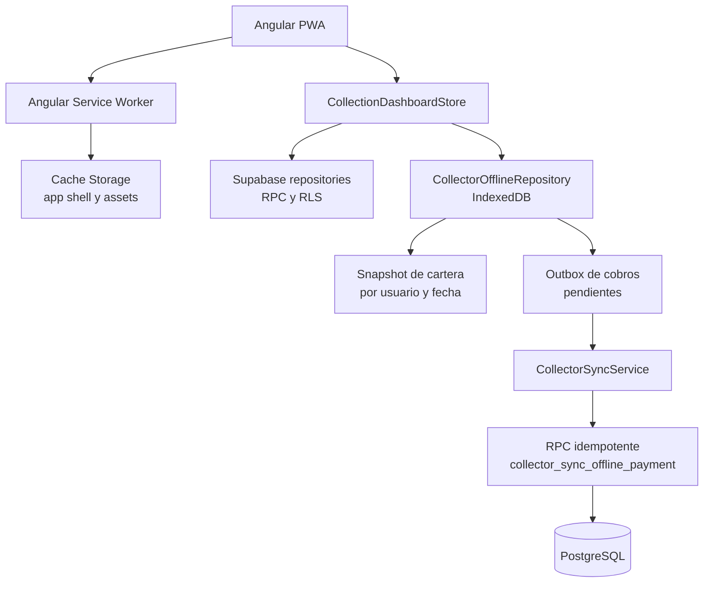

# Especificación técnica: PWA y operación sin conexión para cobradores

**Proyecto:** CobranzaPro  
**Estado:** propuesta técnica  
**Fecha:** 22 de noviembre de 2026  
**Alcance principal:** instalación desde Chrome y continuidad operativa de cobradores ante cortes de Internet

## 1. Decisión recomendada

La aplicación puede y debe convertirse en una **Progressive Web App (PWA)** para que el
usuario pueda instalarla desde Chrome en Android y escritorio. Es una mejora viable y de
bajo costo.

Sin embargo, hacerla instalable no vuelve automáticamente offline a Supabase ni a los
procesos financieros. La solución debe dividirse en dos capacidades:

1. **PWA instalable:** cachea la aplicación Angular para abrirla sin red y ofrecer una
   experiencia similar a una aplicación móvil.
2. **Modo offline de negocio:** conserva una copia mínima de la cartera del cobrador y,
   posteriormente, permite registrar cobros pendientes de sincronización con controles
   contra duplicados.

La recomendación es implementar por etapas:

- **Etapa 1:** PWA instalable, detección de conexión y cartera offline de solo lectura.
- **Etapa 2:** registro offline de cobros como operaciones pendientes, con sincronización
  idempotente y confirmación del servidor.
- **No incluir inicialmente:** creación offline de clientes, préstamos, renovaciones,
  anulaciones ni cierres de caja definitivos.

La PWA se construye una sola vez para toda la aplicación. No conviene mantener una segunda
aplicación exclusiva para cobradores. Lo que se restringe por rol es la **funcionalidad
offline y los datos persistidos**, no la instalación del shell de Angular.

## 2. Conclusión de viabilidad

| Capacidad | Viabilidad | Complejidad | Recomendación |
|---|---|---:|---|
| Instalar desde Chrome | Alta | Baja | Implementar. |
| Abrir la interfaz sin Internet | Alta | Baja | Implementar con Angular Service Worker. |
| Ver la última cartera descargada | Alta | Media | Implementar solo para cobradores. |
| Registrar un cobro offline | Alta, con restricciones | Alta | Segunda etapa. |
| Sincronizar cobros automáticamente | Alta | Alta | Usar idempotencia en PostgreSQL. |
| Iniciar sesión por primera vez offline | No recomendable | Alta/riesgosa | Requiere conexión. |
| Crear préstamos/clientes offline | Técnicamente posible | Muy alta | Fuera del alcance inicial. |
| Cierre de caja definitivo offline | No recomendable | Muy alta | Requiere confirmación del servidor. |

## 3. Estado actual verificado

El proyecto todavía no tiene soporte PWA:

- no existe `@angular/service-worker` en `package.json`;
- `angular.json` no configura `serviceWorker`;
- no existe `ngsw-config.json`;
- no existe `manifest.webmanifest`;
- `src/index.html` no enlaza un manifiesto;
- solo existe `public/favicon.svg`, sin iconos PWA de 192 y 512 píxeles;
- no existe manejo explícito de `online`/`offline` ni almacenamiento IndexedDB.

La cartera del cobrador se obtiene actualmente mediante el RPC
`collector_list_portfolio`. `CollectionDashboardStore.load()` depende completamente de la
red y muestra error si la consulta falla.

El registro de pagos llama directamente a `register_payment`. El servidor controla la
fecha financiera y la aplicación no tiene una cola local.

Además, `AuthService.ensureCurrentAccess()` aplica una política **fail closed**: si no puede
consultar el estado de acceso del cobrador, limpia la sesión. Este comportamiento es seguro
para una aplicación exclusivamente online, pero impide el modo offline y deberá adaptarse
sin debilitar la restricción de 07:00 a 20:00.

## 4. Diferencia entre PWA y aplicación offline

### 4.1 Qué resuelve Angular Service Worker

El Service Worker puede guardar:

- `index.html`;
- archivos JavaScript y CSS compilados;
- fuentes, iconos e imágenes estáticas;
- los chunks lazy ya descargados o configurados para precarga.

Esto permite abrir la aplicación instalada aunque la red no esté disponible.

### 4.2 Qué no resuelve

El Service Worker no convierte automáticamente las llamadas a Supabase en operaciones
offline. Sin conexión no se pueden ejecutar:

- RPC de PostgreSQL;
- validaciones RLS;
- login y renovación de sesión contra Auth;
- Realtime;
- creación o actualización de registros;
- validación del horario por el servidor.

Por eso se necesita una capa local explícita y una estrategia de sincronización.

## 5. Alcance funcional propuesto

### 5.1 Disponible para todos los roles

- instalación desde Chrome;
- apertura en modo `standalone`;
- carga del shell Angular desde caché;
- detección visual de conexión;
- aviso cuando existe una nueva versión;
- actualización controlada de la aplicación.

### 5.2 Disponible offline solo para cobradores

- ver la cartera descargada del día;
- buscar clientes de su propia cartera;
- consultar nombre, dirección, teléfono, cuota y saldo del último snapshot;
- visualizar la fecha y hora de la última sincronización;
- consultar operaciones pendientes del dispositivo;
- en la segunda etapa, crear un borrador de cobro pendiente de sincronización.

### 5.3 No disponible offline inicialmente

- login en un dispositivo nuevo;
- creación o modificación de clientes;
- creación, edición o renovación de préstamos;
- anulación de pagos;
- solicitudes de corrección;
- aprobación de gastos o viáticos;
- cierre de caja definitivo;
- funciones administrativas y reportes actualizados;
- descarga de fotografías o historiales completos.

## 6. Arquitectura propuesta



### 6.1 Almacenamientos separados

| Almacenamiento | Contenido | No debe contener |
|---|---|---|
| Cache Storage | HTML, JS, CSS, iconos y assets versionados | Respuestas financieras de Supabase. |
| IndexedDB | Snapshot mínimo de cartera y outbox | Tokens copiados, fotos o historial innecesario. |
| Supabase | Fuente autoritativa y operaciones confirmadas | Operaciones locales no validadas. |

No se deben agregar las URL de Supabase a `dataGroups` de `ngsw-config.json`. Cachear
respuestas autenticadas por URL puede mezclar datos entre sesiones, mantener información
personal después del logout y devolver saldos obsoletos sin control del dominio.

## 7. Instalación PWA con Angular 22

Angular proporciona el schematic oficial:

```powershell
pnpm exec ng add @angular/pwa@22.2.3 --project cobranza-pro --skip-confirmation
```

Antes de implementarlo debe comprobarse que la versión coincida con el resto de paquetes
Angular instalados. El schematic realiza normalmente estos cambios:

- agrega `@angular/service-worker`;
- habilita Service Worker en el build de producción;
- registra `provideServiceWorker()` en los providers raíz;
- crea `ngsw-config.json`;
- crea `public/manifest.webmanifest`;
- agrega iconos PWA;
- enlaza el manifiesto desde `src/index.html`.

Los archivos generados deben revisarse; el schematic es un punto de partida, no una
configuración final de seguridad.

### 7.1 Manifiesto requerido

```json
{
  "id": "/",
  "name": "CobranzaPro",
  "short_name": "CobranzaPro",
  "lang": "es-PE",
  "start_url": "/",
  "scope": "/",
  "display": "standalone",
  "theme_color": "#121212",
  "background_color": "#121212",
  "icons": [
    {
      "src": "icons/icon-192x192.png",
      "sizes": "192x192",
      "type": "image/png",
      "purpose": "any maskable"
    },
    {
      "src": "icons/icon-512x512.png",
      "sizes": "512x512",
      "type": "image/png",
      "purpose": "any maskable"
    }
  ]
}
```

La instalación siempre requiere consentimiento controlado por el navegador. La aplicación
puede ofrecer un botón “Instalar aplicación”, pero no puede instalarse silenciosamente.

### 7.2 Requisitos del hosting

- HTTPS obligatorio en producción; Cloudflare ya lo proporciona.
- `manifest.webmanifest` servido con tipo MIME correcto.
- `ngsw-worker.js` servido como JavaScript y nunca como fallback HTML.
- `ngsw.json` disponible después de cada despliegue.
- el fallback SPA no debe ocultar errores de archivos PWA inexistentes.
- los archivos de control del Service Worker no deben quedar retenidos por una caché CDN
  incompatible con las actualizaciones de Angular.

## 8. Configuración de caché Angular

El `ngsw-config.json` debe enfocarse en activos de la aplicación:

```json
{
  "$schema": "./node_modules/@angular/service-worker/config/schema.json",
  "index": "/index.html",
  "assetGroups": [
    {
      "name": "app-shell",
      "installMode": "prefetch",
      "resources": {
        "files": ["/favicon.svg", "/index.html", "/manifest.webmanifest", "/*.css", "/*.js"]
      }
    },
    {
      "name": "assets",
      "installMode": "lazy",
      "updateMode": "prefetch",
      "resources": {
        "files": ["/icons/**", "/*.(png|jpg|jpeg|svg|webp|woff2)"]
      }
    }
  ]
}
```

La configuración exacta debe validarse contra la salida real del builder
`@ngx-env/builder:application`.

No se propone `applicationMaxAge` en la primera versión. Si se configura y vence, Angular
deja de servir la aplicación offline hasta descargar un build nuevo, lo que podría bloquear
al cobrador durante una ruta.

## 9. Modelo de datos local

Se recomienda IndexedDB para información estructurada. `localStorage` es síncrono, pequeño y
no ofrece transacciones adecuadas para una cola financiera.

Puede utilizarse la librería ESM `idb` para evitar una implementación manual compleja de la
API de IndexedDB. Es una dependencia nueva justificada; Dexie sería más potente, pero no es
necesario para este alcance.

### 9.1 Snapshot de cartera

```ts
interface OfflinePortfolioSnapshot {
  key: string; // projectRef:userId:businessDate
  userId: string;
  businessDate: string;
  downloadedAt: string;
  expiresAt: string;
  schemaVersion: number;
  entries: OfflinePortfolioEntry[];
}
```

Cada entrada debe contener únicamente los campos necesarios para realizar la ruta:

- identificadores de cliente y préstamo;
- nombre y DNI parcialmente visible cuando corresponda;
- teléfono y dirección;
- monto de cuota, saldo y estado calculado al momento del snapshot;
- fecha/hora de actualización.

No debe persistirse historial completo de pagos, observaciones sensibles ni información de
otros cobradores.

### 9.2 Outbox de cobros

```ts
type OfflinePaymentStatus =
  | 'pending'
  | 'syncing'
  | 'synced'
  | 'requires_review'
  | 'rejected';

interface OfflinePaymentOperation {
  operationId: string; // UUID generado una sola vez
  userId: string;
  customerId: string;
  loanId: string;
  amount: number;
  paymentMethod: 'cash' | 'transfer';
  notes: string | null;
  capturedAtClient: string;
  businessDateClaim: string;
  status: OfflinePaymentStatus;
  attempts: number;
  lastErrorCode: string | null;
  createdAt: string;
}
```

`capturedAtClient` es evidencia declarada por el dispositivo, no una fecha financiera
confiable. El cliente puede tener la hora incorrecta o manipulada.

## 10. Patrón Repository en la aplicación

La implementación debe respetar la arquitectura actual:

```text
core/models/
  offline-collector.model.ts
core/repositories/
  collector-offline.repository.ts
core/adapters/
  indexeddb-collector-offline.repository.ts
modules/collector/offline/
  collector-connectivity.ts
  collector-sync.store.ts
  collector-sync.service.ts
```

### Responsabilidades

- `COLLECTOR_PORTFOLIO_REPOSITORY`: continúa representando la fuente remota Supabase.
- `COLLECTOR_OFFLINE_REPOSITORY`: persiste y lee snapshot/outbox en IndexedDB.
- `CollectionDashboardStore`: intenta cargar Supabase; si funciona, actualiza el snapshot.
  Ante un error de red, usa el snapshot válido del mismo cobrador y fecha.
- `CollectorSyncService`: envía la outbox en orden y reconcilia el resultado.
- `CollectorSyncStore`: expone señales de conexión, pendientes, sincronización y errores.

No se debe reemplazar el repository remoto por un mock ni introducir una librería global de
estado.

## 11. Estrategia de carga offline-first

```text
Abrir módulo cobrador
        ↓
¿Hay conexión y sesión válida?
   Sí                     No
   ↓                       ↓
Consultar Supabase    Leer snapshot local
   ↓                       ↓
Actualizar IndexedDB  Mostrar “datos del <fecha>”
   ↓                       ↓
Mostrar datos frescos Deshabilitar acciones no soportadas
```

Reglas:

1. Supabase siempre es la fuente autoritativa.
2. El snapshot nunca se mezcla entre usuarios.
3. Un snapshot de otro día no se presenta como cartera actual.
4. La interfaz muestra claramente si los datos están desactualizados.
5. Al recuperar conexión se recarga la cartera y luego se sincroniza la outbox.

## 12. Sincronización de pagos

### 12.1 No reutilizar directamente `register_payment`

La operación offline necesita idempotencia. Reintentar una llamada tras una conexión
inestable podría registrar el mismo pago dos veces.

Se recomienda una nueva migración y un RPC específico:

```text
collector_sync_offline_payment(
  p_operation_id uuid,
  p_loan_id uuid,
  p_amount numeric,
  p_payment_method text,
  p_notes text,
  p_business_date_claim date,
  p_captured_at_client timestamptz
)
```

El backend debe:

- validar `auth.uid()` y rol cobrador;
- confirmar que el préstamo pertenece a su cartera;
- validar préstamo activo, monto, saldo y método;
- aplicar las mismas reglas financieras de `register_payment`;
- mantener `paid_at` y el momento contable bajo control del servidor;
- registrar `captured_at_client` únicamente como auditoría;
- persistir `operation_id` con índice `UNIQUE`;
- devolver el mismo resultado si se repite el mismo `operation_id` con el mismo payload;
- rechazar el ID reutilizado con un payload diferente;
- rechazar días de caja ya validados;
- registrar `synced_at` en el servidor.

La lógica financiera existente debe reutilizarse internamente. No deben crearse dos
implementaciones distintas para asignar pagos a cuotas.

### 12.2 Estados visibles

Un cobro offline no debe mostrarse como pago confirmado.

- **Pendiente:** guardado solo en el dispositivo.
- **Sincronizando:** se está enviando al servidor.
- **Confirmado:** Supabase devolvió el `payment_id`.
- **Requiere revisión:** no puede contabilizarse automáticamente.
- **Rechazado:** contradice una regla vigente.

La UI debe diferenciar “cobrado confirmado” de “cobro pendiente de sincronización”.

### 12.3 Disparadores de sincronización

- al iniciar la aplicación con conexión;
- cuando el navegador emite `online`;
- al volver la pestaña a primer plano;
- mediante botón “Sincronizar ahora”;
- después de registrar una operación si ya volvió la red.

El evento `online` es solo una señal: antes de enviar debe comprobarse Supabase mediante una
operación segura.

No se debe depender exclusivamente de Background Sync. Esta API tiene disponibilidad
limitada entre navegadores. La primera versión sincronizará mientras la aplicación esté
abierta; Background Sync puede añadirse después como mejora progresiva para Chrome.

## 13. Horario de acceso de cobradores

La aplicación aplica actualmente 07:00 inclusive a 20:00 exclusiva en `America/Lima` y
falla de forma cerrada cuando no puede verificarlo. El modo offline crea una limitación
inevitable: sin servidor no existe una autoridad remota que confirme la hora, revoque la
sesión o borre datos del dispositivo.

### Política propuesta

1. Al conectarse, el servidor entrega un **lease de acceso** con usuario, fecha de negocio,
   hora del servidor y vencimiento a las 20:00.
2. El dispositivo solo muestra el snapshot offline mientras ese lease siga vigente.
3. A las 20:00 la aplicación bloquea el módulo, oculta la cartera y elimina el snapshot del
   día según la política aprobada.
4. Ninguna operación offline se confirma financieramente sin volver a validar en el
   servidor.
5. El backend conserva todas las restricciones actuales; la PWA nunca las reemplaza.

### Limitación de seguridad

Un usuario con control total del dispositivo puede modificar el reloj o inspeccionar el
almacenamiento local. Ninguna PWA puede garantizar una revocación remota mientras el equipo
está totalmente desconectado.

Las mitigaciones son:

- persistir la menor cantidad posible de datos;
- limitar el snapshot al cobrador y día actuales;
- ocultar o enmascarar datos no necesarios;
- borrar datos en logout, cambio de usuario, vencimiento y desactivación detectada;
- exigir bloqueo de pantalla del dispositivo;
- documentar el riesgo de pérdida o robo del teléfono.

Si el cliente exige que la información sea inaccesible de manera absoluta después de las
20:00 incluso con el dispositivo sin red y manipulado, una PWA no alcanza esa garantía. Se
necesitaría control del dispositivo mediante MDM y posiblemente una aplicación nativa.

## 14. Manejo de cobros después de las 20:00

Caso crítico:

```text
19:40  Cobrador registra un cobro sin red
20:00  Finaliza su horario
20:15  Regresa Internet
```

El sistema no debe saltarse el horario ni backdatear silenciosamente el pago.

Propuesta:

- la operación queda `requires_review`;
- no se modifica automáticamente la caja validada;
- un administrador/supervisor revisa cliente, monto y evidencia;
- la resolución queda auditada;
- el flujo de excepción se define antes de habilitar pagos offline en producción.

Mientras ese flujo no esté aprobado, la Etapa 1 será únicamente de consulta offline.

## 15. Seguridad de datos locales

### 15.1 Reglas obligatorias

- IndexedDB se separa por `projectRef`, `userId` y `businessDate`.
- Logout elimina snapshot, outbox confirmada y datos del usuario.
- Cambio de usuario elimina primero el almacenamiento anterior.
- Nunca almacenar PIN, contraseña ni copia manual del JWT.
- No almacenar `service_role` ni secretos adicionales.
- Aplicar Content Security Policy para reducir riesgo XSS.
- Mantener dependencias fijadas y sin scripts remotos.
- No escribir datos de clientes en logs o telemetría.

### 15.2 Cifrado local

IndexedDB no debe tratarse como una bóveda segura. Puede cifrarse el snapshot con Web Crypto
AES-GCM y una clave no extraíble asociada al dispositivo. Esto reduce exposición frente a
una lectura casual del almacenamiento, pero no protege contra JavaScript malicioso ejecutado
en el mismo origen.

El cifrado local es defensa adicional; no reemplaza CSP, minimización de datos ni seguridad
del teléfono.

## 16. Experiencia de usuario

### 16.1 Estados globales

La cabecera debe mostrar uno de estos estados:

- **En línea:** datos sincronizados.
- **Sin conexión:** usando datos guardados a las `HH:mm`.
- **N cobros pendientes:** operaciones todavía no confirmadas.
- **Sincronizando:** no cerrar la aplicación.
- **Requiere revisión:** existe una operación que no pudo contabilizarse.

### 16.2 Reglas de interacción

- No mostrar errores técnicos de red en cada tarjeta.
- Mostrar la fecha del snapshot de manera visible.
- Deshabilitar acciones no soportadas y explicar por qué.
- No emitir un comprobante definitivo antes de la confirmación del servidor.
- Evitar recargar la aplicación mientras hay una outbox en transición.
- Permitir reintento manual sin crear una nueva `operationId`.

### 16.3 Instalación

El botón de instalación debe mostrarse únicamente cuando el navegador permita instalar. Si
Chrome no ofrece el evento correspondiente, se puede mostrar una guía breve “Menú de Chrome
→ Instalar aplicación”.

## 17. Actualizaciones de la PWA

Angular puede descargar una nueva versión en segundo plano mediante `SwUpdate`.

Política propuesta:

1. Escuchar `versionUpdates`.
2. Informar “Hay una actualización disponible”.
3. Si no existen operaciones pendientes, permitir “Actualizar ahora”.
4. Si hay outbox pendiente, sincronizar o conservarla antes de recargar.
5. Nunca forzar un reload durante un registro de cobro.
6. Versionar el esquema de IndexedDB y migrarlo antes de leer datos anteriores.

Si una versión no puede instalarse, se mantiene la versión funcional anterior y se registra
el error sin bloquear la ruta del cobrador.

## 18. Costos

### 18.1 Costos de software

- Angular Service Worker: sin licencia de pago.
- Web App Manifest: estándar web, sin costo.
- IndexedDB y Cache Storage: APIs del navegador, sin costo.
- Librería `idb`: código abierto, sin servicio pagado.
- Instalación desde Chrome: sin tienda ni pago por usuario.

### 18.2 Costos de infraestructura

La PWA utiliza el mismo despliegue de Cloudflare Workers Static Assets. Puede aumentar
ligeramente las solicitudes y almacenamiento en caché, pero también reduce descargas
repetidas.

La sincronización de una cola genera llamadas pequeñas a Supabase. Para seis o siete
cobradores, el volumen esperado no justifica infraestructura adicional. El límite relevante
será la cuota normal del plan Supabase y no la instalación PWA.

No se necesita Realtime para sincronizar la outbox.

## 19. Estrategia de pruebas

### 19.1 Unitarias

- snapshot separado por usuario y fecha;
- fallback local solo ante errores de conectividad;
- snapshot vencido rechazado;
- logout elimina datos;
- una operación conserva el mismo `operationId` en cada reintento;
- estados de outbox y errores recuperables;
- actualización bloqueada mientras existe una escritura en curso.

### 19.2 PostgreSQL/pgTAP

- cobrador no sincroniza pagos de otra cartera;
- `operationId` repetido no duplica el pago;
- mismo ID con payload diferente es rechazado;
- caja validada permanece inmutable;
- saldo e imputaciones coinciden con `register_payment`;
- acceso fuera de horario conserva la política aprobada;
- operación tardía pasa a revisión y no se contabiliza silenciosamente.

### 19.3 E2E PWA

- manifiesto e iconos disponibles por HTTPS;
- instalación reconocida por Chrome;
- recarga offline después de una primera visita online;
- navegación por rutas lazy del cobrador previamente descargadas;
- cartera del cobrador visible desde IndexedDB;
- rutas administrativas no muestran información cacheada;
- cobro pendiente se sincroniza exactamente una vez al volver la red;
- logout impide recuperar el snapshot anterior;
- actualización de versión no pierde la outbox.

Playwright puede simular el modo offline para las pruebas automatizadas. La aceptación final
debe realizarse además en un Samsung S21 o dispositivo equivalente con Chrome real.

### 19.4 Matriz mínima de dispositivos

| Dispositivo/navegador | Prioridad | Alcance |
|---|---:|---|
| Chrome Android, Samsung S21 | Crítica | Instalación, ruta y sincronización. |
| Chrome Android actual | Alta | Compatibilidad general. |
| Chrome escritorio | Media | Administración e instalación opcional. |
| Samsung Internet | Media | Apertura y fallback; instalación según soporte. |
| Safari iOS | Baja inicial | No prometer Background Sync. |

## 20. Plan de implementación

### Fase 0 — validación funcional

- Confirmar qué datos necesita realmente el cobrador sin conexión.
- Definir qué ocurre con un cobro que no sincroniza antes de las 20:00.
- Aprobar retención local y política ante teléfono perdido.

**Salida:** reglas de negocio cerradas antes de modificar pagos.

### Fase 1 — PWA instalable

- agregar `@angular/service-worker`;
- configurar manifest, iconos y `ngsw-config.json`;
- integrar `SwUpdate`;
- verificar Cloudflare y HTTPS;
- agregar pruebas de instalación y recarga offline del shell.

**Salida:** CobranzaPro instalable desde Chrome.

### Fase 2 — cartera offline de solo lectura

- crear repository IndexedDB;
- guardar snapshot mínimo por cobrador y día;
- agregar estado de conexión y última actualización;
- adaptar el control de acceso mediante lease;
- purgar datos al cerrar sesión o vencer.

**Salida:** el cobrador puede consultar su ruta durante un corte de red.

### Fase 3 — outbox de cobros

- diseñar migración y RPC idempotente;
- agregar cola local y servicio de sincronización;
- distinguir pagos pendientes y confirmados;
- manejar rechazos y revisión administrativa;
- cubrir integridad con pgTAP, unitarias y E2E.

**Salida:** cobros offline sincronizados sin duplicidad.

### Fase 4 — piloto controlado

- habilitar primero a un cobrador;
- operar durante una o dos semanas;
- medir fallos, tiempo sin conexión y operaciones pendientes;
- revisar consumo y soporte;
- ampliar al resto solo después de la aceptación.

## 21. Criterios de aceptación

### PWA

- [ ] Chrome ofrece instalar CobranzaPro.
- [ ] La aplicación instalada abre en modo `standalone`.
- [ ] El shell carga sin red después de una visita online.
- [ ] Los chunks necesarios del cobrador están disponibles offline.
- [ ] Una actualización no destruye datos locales pendientes.
- [ ] Cloudflare sirve correctamente manifest, `ngsw-worker.js` y `ngsw.json`.

### Datos offline

- [ ] Solo se guarda la cartera del usuario autenticado.
- [ ] Se muestra fecha y hora del snapshot.
- [ ] Logout y cambio de usuario eliminan datos anteriores.
- [ ] No se cachean respuestas Supabase mediante `dataGroups` genéricos.
- [ ] El modo offline respeta el lease y oculta datos vencidos.

### Pagos offline

- [ ] Un reintento nunca duplica un pago.
- [ ] El servidor revalida todas las reglas financieras y RLS.
- [ ] La fecha del dispositivo no controla el asiento financiero.
- [ ] Los pagos tardíos no modifican una caja validada.
- [ ] La UI diferencia pendiente, confirmado, rechazado y revisión.
- [ ] Existe recuperación ante cierre de pestaña o reinicio del teléfono.

## 22. Riesgos y mitigaciones

| Riesgo | Consecuencia | Mitigación |
|---|---|---|
| Confundir PWA con offline total | Funciones fallan sin red | Alcance por fases. |
| Pago enviado varias veces | Duplicidad financiera | `operationId` único en PostgreSQL. |
| Hora del teléfono manipulada | Backdating incorrecto | Tiempo contable controlado por servidor. |
| Teléfono perdido | Exposición de cartera | Datos mínimos, purge, bloqueo del dispositivo y TTL. |
| Datos de otro usuario en caché | Fuga de información | Namespace por usuario y limpieza estricta. |
| Service Worker sirve versión antigua | Errores de compatibilidad | `SwUpdate` y schema versionado. |
| Background Sync no disponible | Operaciones no enviadas | Sincronizar al abrir, volver online y manualmente. |
| Corte después de las 20:00 | Pago no contabilizable | Flujo `requires_review`. |
| Caché de API autenticada | Datos obsoletos o cruzados | No cachear Supabase con `dataGroups`. |

## 23. Fuera de alcance inicial

- aplicación nativa Android/iOS;
- sincronización entre múltiples dispositivos offline;
- soporte offline completo para administradores y supervisores;
- creación offline de clientes o préstamos;
- cierre de caja definitivo offline;
- almacenamiento offline de fotos del DNI o cliente;
- garantía de revocación remota sobre un dispositivo desconectado;
- dependencia obligatoria de Background Sync.

## 24. Recomendación final

La propuesta es viable y tiene sentido para cobradores que normalmente disponen de Internet,
pero atraviesan zonas con conectividad inestable.

Debe evitarse el error de intentar hacer toda la aplicación offline desde el inicio. La
estrategia proporcional es:

1. instalar CobranzaPro como PWA;
2. ofrecer cartera offline de solo lectura;
3. observar el uso real;
4. habilitar cobros offline únicamente después de cerrar idempotencia, horario, caja y
   revisión administrativa.

Esta secuencia entrega valor temprano sin comprometer la integridad financiera.

## 25. Referencias oficiales

- [Angular: Getting started with service workers](https://angular.dev/ecosystem/service-workers/getting-started)
- [Angular: Service worker configuration](https://angular.dev/ecosystem/service-workers/config)
- [Angular: Communicating with the service worker](https://angular.dev/ecosystem/service-workers/communications)
- [Chrome: requisitos del Web App Manifest](https://developer.chrome.com/docs/lighthouse/pwa/installable-manifest)
- [Chrome DevTools: depuración de PWA](https://developer.chrome.com/docs/devtools/progressive-web-apps)
- [web.dev: almacenamiento offline](https://web.dev/learn/pwa/offline-data)
- [web.dev: actualización de datos PWA](https://web.dev/learn/pwa/update)
- [MDN: Background Synchronization API](https://developer.mozilla.org/en-US/docs/Web/API/Background_Synchronization_API)
- [Supabase: inicialización del cliente JavaScript](https://supabase.com/docs/reference/javascript/initializing)
- [Supabase: sesiones de usuario](https://supabase.com/docs/guides/auth/sessions)
